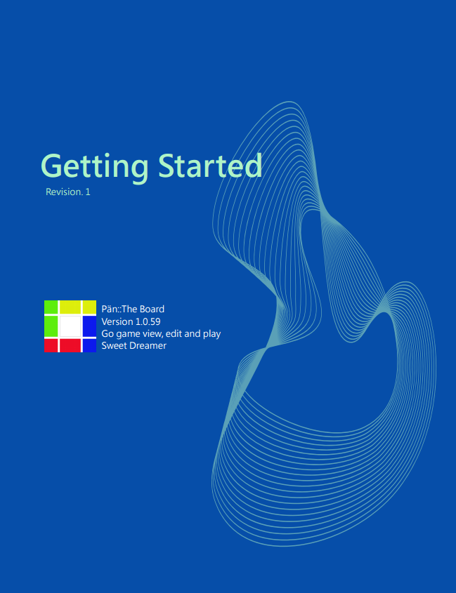
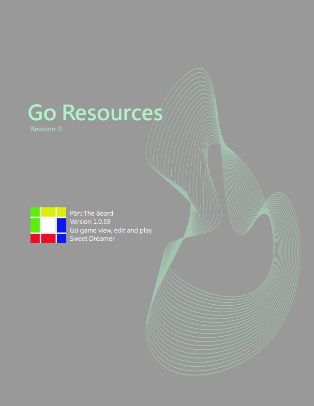

### User's manual and sample files

|                     |                     |                     |          
|:-------------------:|:-------------------:|:-------------------:|
|Basic operation External KataGo setup| |Sample file for manual :  <a href="https://wildcard-theboard.github.io/Pan-TheBoard/Manual/Document/Getting Started.gbf">Getting Started.gbf</a>   <a href="https://wildcard-theboard.github.io/Pan-TheBoard/Manual/Document/Sample_GBF_1_File.gbf">Sample_GBF_1_File.gbf</a> To check out the performance with some  exceptional cases such as supr Ko.|
|Go resources and  user defined infolist handling  | |Sample for Custom Resource.  Copy and paste  the text into your CustomeResources.dat  to build user defined infolist:  <a href="https://wildcard-theboard.github.io/Pan-TheBoard/Manual/Document/CustomResources.txt">CustomResources.txt</a>|        

  
 build user defined infolist:  <a href="https://wildcard-theboard.github.io/Pan-TheBoard/Manual/Document/CustomResources.datr">CustomResources</a>
  
#### * Known issue under review

|                       |                         |
|:----------------------|:------------------------|
| Game tree view | There were some tries of its performance improvement. Wrong symbol could be displayed on game title yet, but it should be OK in use as it does not affect on the information structure. |

